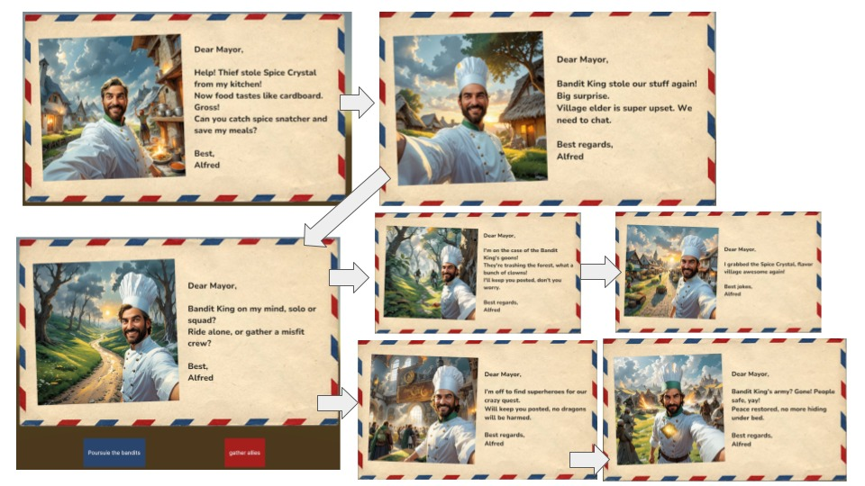
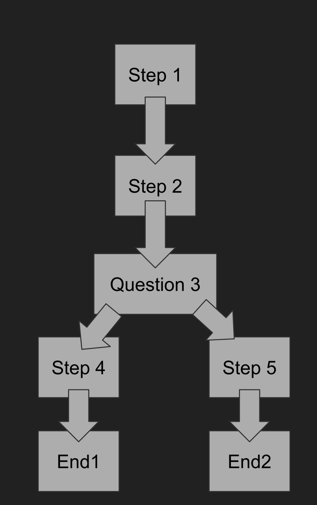
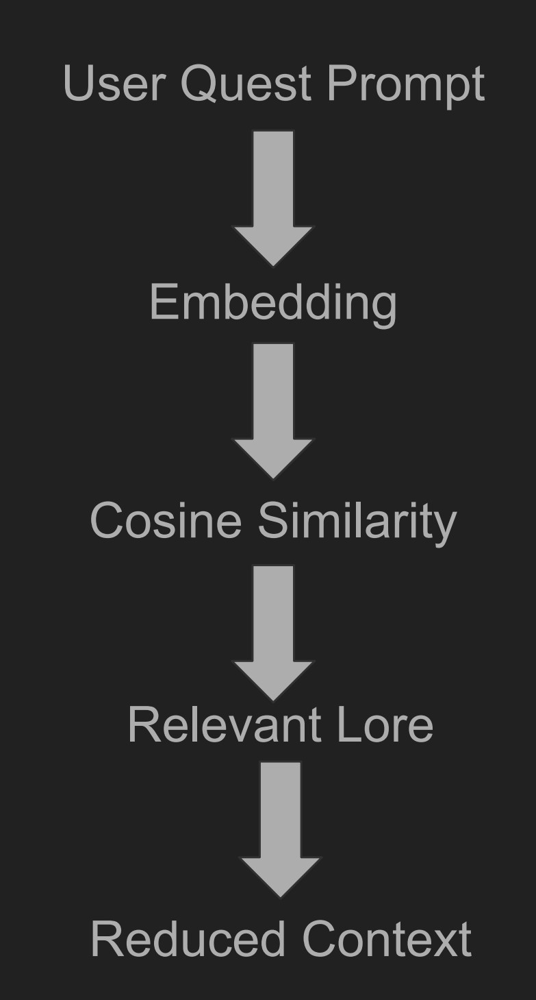
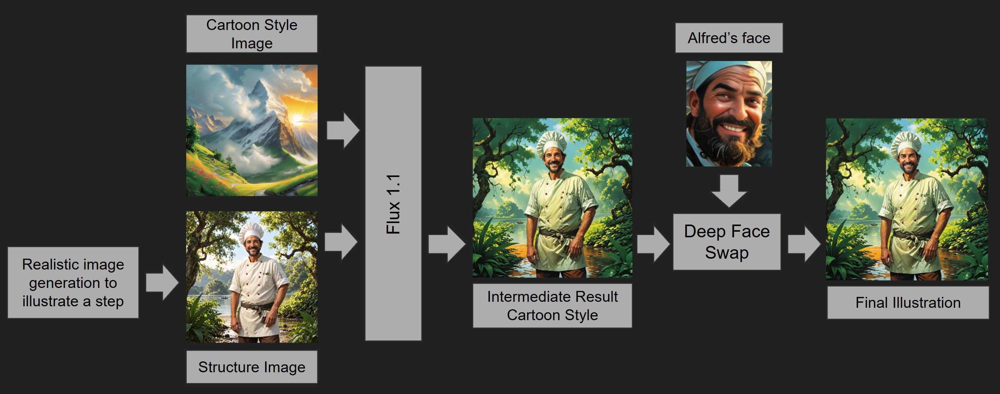
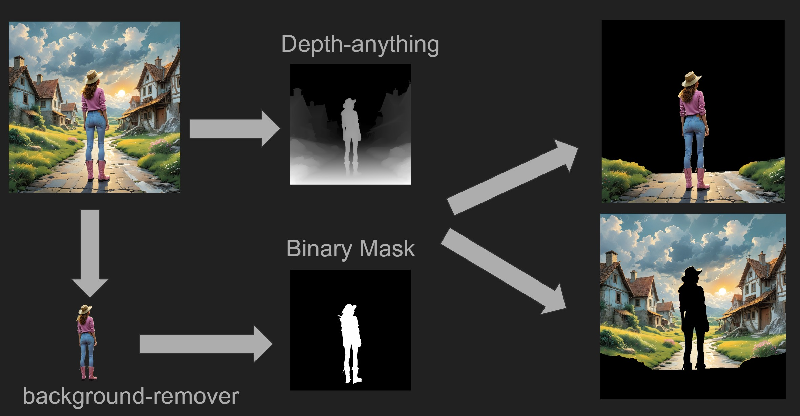
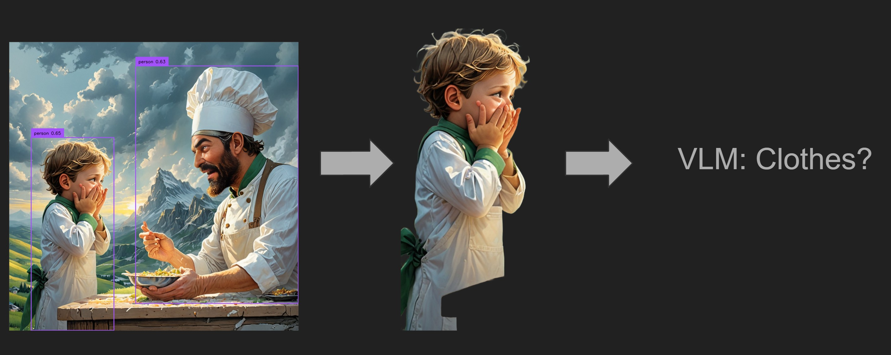
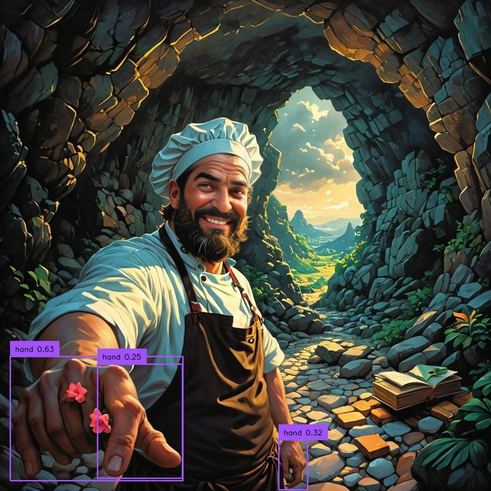

# Controlling Generative AI for Game Content

*R&D project developed at OZWE · Early 2025 · 5 min read*

It all started with a request from our client to explore new ways of using AI to create game content. At OZWE, we began investigating a generative quest system. How much could AI handle, which parts should remain scripted, and could we use AI to help verify its own output?

Our prototype followed Alfred, a cook travelling through different biomes to find new spices for his village. His adventures would arrive as humorous postcards, with illustrations and choices that shaped the quest.

*The prototype: an adventure told through postcards and player choices.*

## The original question

The goal was not complete autonomy. A designer would describe a quest, and the system would help turn that intention into game content.

We needed three things:

- A funny, coherent story with clear progression and endings.
- Content that respected the game's lore.
- Illustrations that followed the story and stayed consistent.

The central trade-off was AI control versus creative freedom.

## Zero-shot generation wasn't enough

We first asked the LLM to generate Alfred's adventure directly, without preprocessing. It could produce a story, but looking at the whole quest revealed problems:

- Story elements were inconsistent or lost focus.
- Some outcomes did not conclude the adventure.
- The humour and context were not always clear enough for a standalone postcard.

The next question was how to control the narrative arc while keeping room for generation.

## Adding structure

We took a divide and conquer approach: break the quest into steps, questions, branches, and outcomes, then generate content within that structure.

This made the progression explicit and easier to inspect. However, it did not guarantee that the content would fit the game world. Including all the lore introduced another problem: too much context.

<figure>
  
  <figcaption><em>Breaking the quest into explicit steps, choices and endings made its progression easier to control.</em></figcaption>
</figure>

## Grounding generation in the game world

We tried inserting lore into generated variables and supplying it directly in prompts. Local replacements did not necessarily preserve the whole story, and the full lore was difficult to fit into the model's context.

We then explored retrieval-augmented generation, or RAG:

- Split the lore into smaller pieces and precompute their embeddings.
- Retrieve pieces relevant to the designer's prompt using cosine similarity.
- Generate with that smaller, focused context.

Our trials showed better lore compliance and consistency between steps. These were qualitative observations from the prototype.

<figure style="margin: 1.5rem 0;">
  
  <figcaption><em>Retrieval selected the relevant knowledge before generation, reducing the amount of lore placed in context.</em></figcaption>
</figure>

## Generation needs evaluation

Even with structure and relevant lore, the model could introduce unsupported elements. We explored an analysis step that classified story elements by their source: the lore, the designer's request, or neither.

That diagnosis could guide a revision. It also raised another question: how reliable was the model doing the checking?

## Controlling the illustrations

In parallel, we explored postcard illustrations. Direct generation produced reasonable images, but clothing, character appearance, and style could change between cards.

We investigated separating three concerns:

- **Composition:** use a structure image to guide the scene.
- **Style:** use a reference image to guide its visual treatment.
- **Identity:** explore face swapping to preserve Alfred's appearance.

*Reconstruction of the explored approach, using illustrative examples rather than original outputs from every named tool. Open the image for a closer look.*

## Checking smaller parts of the image

We experimented with vision-language models (VLMs) to check the generated images. Their descriptions captured the overall scene but often missed details or mixed foreground and background.

Again, we decomposed the problem: use depth and masks to separate regions, then ask more specific questions about clothing, objects, or scenery.

*Separating the scene gives the evaluator a smaller region to inspect.*

We also explored detecting individual characters and isolating them for clothing checks.

  
Example: isolating a character for evaluation

  

However, finding a region did not guarantee a correct evaluation. Detecting a hand and judging its anatomy remained different problems.

<figure style="margin: 1.5rem 0;">
  

    
    
  

  <figcaption><em>A detected hand and its close-up: localisation alone does not establish anatomical correctness.</em></figcaption>
</figure>

Missing details, incorrect clothing, and small deformations remained limitations of the experiments.

## What I learned

The research gradually shifted from generating content to building controls around generation:

- Decomposition made the narrative structure explicit.
- Retrieval helped select the right knowledge.
- Local evaluation made details easier to inspect, while introducing its own reliability questions.

These were prototypes exploring different parts of the problem, not one fully reliable, end-to-end generator.

For me, the main lesson was to start with a simple experiment, identify its failure modes, and test a mechanism that addressed a specific problem. That helped us understand what AI could handle, where scripted systems helped, and where the designer still needed control.
