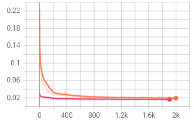
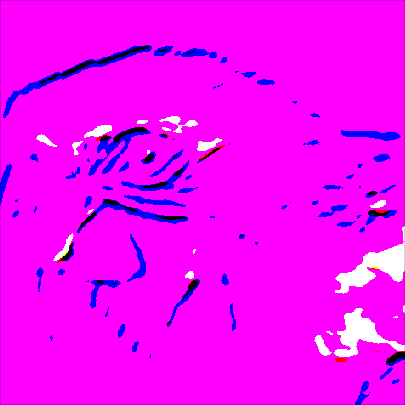
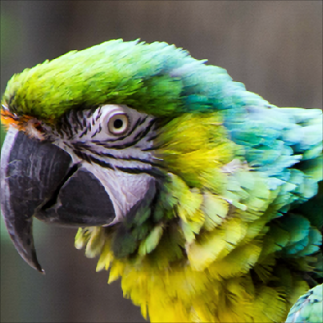
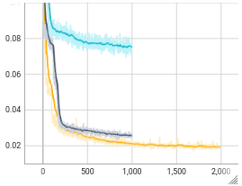
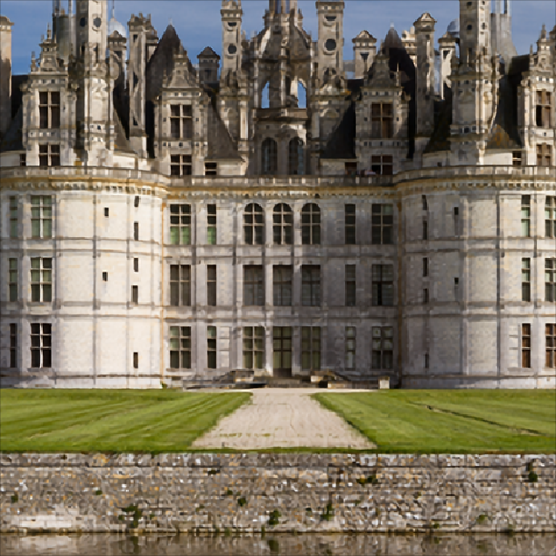
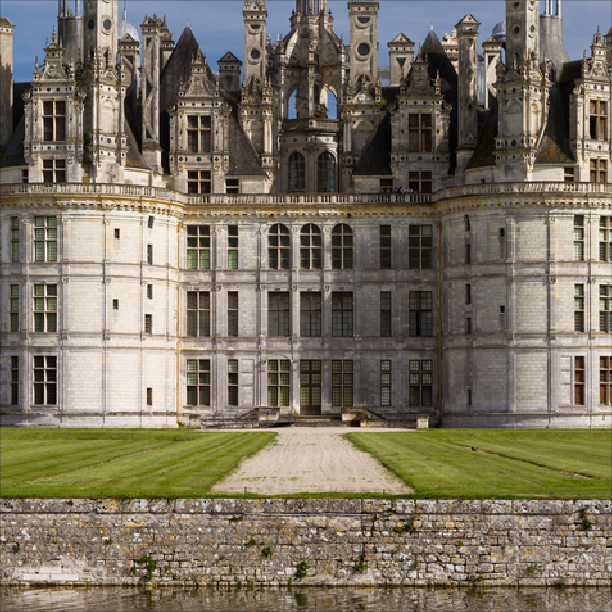

# Learning to Upscale Images with a CNN

*ETH Zurich · 2023 · Python, PyTorch · 5 min read*

Making an image twice as large is easy. Reconstructing its fine details is harder. For an exercise in *Mathematical Foundations of Computer Graphics and Vision* at ETH Zurich, I implemented and trained a small convolutional neural network for ×2 super-resolution. I then tested how its architecture, learning rate and input preparation affected the results.

The comparison below shows bicubic interpolation and the residual model on the same input. Look around the parrot’s eye and the edges of its feathers. The network produces sharper detail, although sharpness alone does not tell us whether every detail is correct.

<figure class="image-compare" data-compare>
  <div class="compare-modes" role="group" aria-label="Compare the CNN with" hidden>
    <button type="button" data-reference="bicubic" data-label="Bicubic interpolation" aria-pressed="true">Bicubic</button>
    <button type="button" data-reference="low-resolution" data-label="Low-resolution input" aria-pressed="false">Low resolution</button>
  </div>
  <div class="compare-labels"><span data-reference-label>Bicubic interpolation</span><span>Residual CNN</span></div>
  <div class="compare-images">
    
    
    
    <span class="compare-divider" aria-hidden="true" aria-label="Reveal the residual CNN result"><svg viewBox="0 0 32 32" fill="none" stroke="currentColor" stroke-width="1.6"><path d="m12 11-5 5 5 5m8-10 5 5-5 5M16 6v20"/></svg></span>
  </div>
  <figcaption>Drag the divider to compare; keyboard arrows work too. Switch between bicubic interpolation and the low-resolution input, enlarged as shown in the original report.</figcaption>
</figure>

## Building the training pipeline

The dataset contained high-resolution images. To create matching training pairs, I took random 64 × 64 crops, varied their brightness, contrast, saturation and hue, and reduced them to 32 × 32 with bilinear downsampling. The original crop supplied the target. This let the model see different patches and colour variations across training epochs.

I implemented the architecture specified by the assignment: bilinear enlargement followed by a fully convolutional network. Its 3 × 3 convolutions use 64 internal channels, with ten convolution/LeakyReLU blocks between the input and output layers. The output has three RGB channels.

<ol class="sr-pipeline" aria-label="Super-resolution pipeline">
  <li><strong>32 × 32</strong><span>Low-resolution input</span></li>
  <li><strong>64 × 64</strong><span>Bilinear enlargement</span></li>
  <li><strong>CNN</strong><span>Learned reconstruction</span></li>
  <li><strong>L1 loss</strong><span>Compare with the target</span></li>
</ol>

For each batch, I computed the mean absolute pixel error, backpropagated it and updated the weights with Adam. TensorBoard tracked the training loss, validation measurements and reconstructed images. The baseline used a learning rate of `1e-4` and ran for approximately 2,000 epochs.

## Learning the correction

The baseline network predicts the complete output image. In the residual version, I added the bilinearly enlarged input to the network’s output:

```python
prediction = (
    upsampled_image
    + network(upsampled_image)
)
```

This gives the model a useful starting image and lets it learn a correction. In these experiments, the residual version began with a much lower loss and converged faster. The visual difference was more modest: both models sharpened the image, while the residual model preserved its overall colour more closely in the examples I examined.

<figure class="sr-plot">
  
  <figcaption>Training L1 loss, lower is better. Orange: baseline. Pink: residual model. Horizontal axis: epochs. Original TensorBoard trace, cropped from the report.</figcaption>
</figure>

## The learning rate changes the result

I tested learning rates from `1e-2` to `1e-6`. The largest settings produced unstable training and severe colour artefacts. At `1e-6`, the model learned too slowly within the available training time; the output remained grey and soft. Of the settings tested, `1e-4` gave the most useful reconstruction.

<figure class="sr-examples">
  <div class="sr-example-grid">
    <div><p><code>1e-2</code> Unstable</p></div>
    <div><p><code>1e-4</code> Useful reconstruction</p></div>
    <div><p><code>1e-6</code> Slow learning</p></div>
  </div>
  <figcaption>Archived predictions from the learning-rate experiment. The smaller-rate runs lasted 1,000 epochs; the baseline ran for about 2,000, so these are not equal-budget final comparisons.</figcaption>
</figure>

<figure class="sr-plot">
  
  <figcaption>Compare the first 1,000 epochs: yellow is <code>1e-4</code>, grey is <code>1e-5</code>, cyan is <code>1e-6</code>. Only the baseline continues to 2,000 epochs.</figcaption>
</figure>

## What the network still misses

The model was trained on bilinearly downsampled images. When I changed that preparation step at evaluation time, the results deteriorated, particularly with nearest-neighbour downsampling. The network had learned to work with a particular kind of input degradation. A model intended for real photographs would need training inputs that reflect their blur, noise and compression.

<figure class="image-compare" data-compare>
  <div class="compare-labels"><span>Residual CNN</span><span>Original reference</span></div>
  <div class="compare-images">
    
    
    <span class="compare-divider" aria-hidden="true" aria-label="Reveal the original castle reference"><svg viewBox="0 0 32 32" fill="none" stroke="currentColor" stroke-width="1.6"><path d="m12 11-5 5 5 5m8-10 5 5-5 5M16 6v20"/></svg></span>
  </div>
  <figcaption>The original image is the reference, not a second model output. Look at the roofline, windows and stone textures to see what the reconstruction loses.</figcaption>
</figure>

I also varied the colour augmentation settings. Those shorter, 400-epoch runs showed no clear improvement, so I kept the baseline settings. This was a useful exercise in building an entire learning pipeline and inspecting its failure cases. If I revisited it, I would first tighten the evaluation protocol and test more realistic image degradations.

*These are archived course experiments from May 2023. The original evaluation accumulated batch metrics and logged `1 − SSIM` under “SSIM”; I have therefore omitted its aggregate score table rather than present those values as benchmark averages.*
