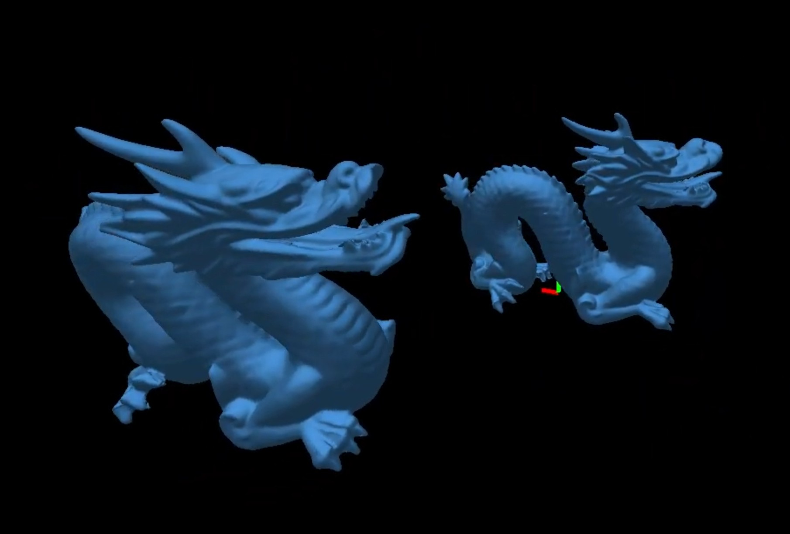

# LevekGL — Learning How Rendering Works

*Student project · 2021–2023 · 3 min read*

I started LevekGL during my studies because I wanted to understand what was happening underneath the game engines I was using. Building a small rendering library felt like the most direct way to learn: isolate one problem, make it visible, then move to the next layer.

*The original dragon render I used while exploring Phong lighting.*

## Starting with the rendering foundations

I began by wrapping the OpenGL objects needed to draw something on screen: vertex and index buffers, vertex arrays, textures, framebuffers and GLSL shaders.

The `RenderingEngine` brought the main services together. It created the GLFW window and input controllers, initialised the OpenGL context, and exposed the renderers and model loader. Each sample still owned its main loop, which kept experiments small and easy to change.

## From a Blender asset to a rendered frame

The next step was to load content made outside the code. I integrated Assimp to read Blender exports and convert them into LevekGL models. A model stored meshes alongside their transforms, while each mesh contained positions, normals, UVs and indices.

Those values were uploaded to GPU buffers, combined with a shader and camera matrices, then submitted through the renderer. This same path supported experiments with cubemaps, framebuffers and shadow maps.

<figure class="architecture-diagram" aria-labelledby="architecture-caption">
  

    
<strong>Blender / OBJ / DAE</strong>Source assets

    
<strong>AssimpModelLoader</strong>Import and conversion

    
<strong>Model</strong>Mesh + Transform

    
<strong>GPU buffers</strong>VAO + VBO + IBO

    
<strong>Shader + Camera</strong>GLSL and matrices

    
<strong>Renderer</strong>Frame or framebuffer

  

  
<strong>Runtime services</strong>GLFW windowInputTexturesCubemapsLine and point rendering

  <figcaption id="architecture-caption"><em>The actual data path used by the examples in the repository.</em></figcaption>
</figure>

## Three concrete milestones

<section class="video-grid" aria-label="LevekGL development videos">
  <article class="video-card">
    <h3>1. Phong lighting</h3>
    
<iframe src="https://www.youtube-nocookie.com/embed/gkXITu7ezkk" title="LevekGL OpenGL Phong lighting demonstration" loading="lazy" allow="accelerometer; autoplay; clipboard-write; encrypted-media; gyroscope; picture-in-picture; web-share" allowfullscreen></iframe>

    
This experiment made the relationship between geometry, normals, diffuse light and specular highlights concrete.

  </article>
  <article class="video-card">
    <h3>2. Loading Blender scenes</h3>
    
<iframe src="https://www.youtube-nocookie.com/embed/X7YxfDeLgOw" title="LevekGL Blender scene loading with Assimp demonstration" loading="lazy" allow="accelerometer; autoplay; clipboard-write; encrypted-media; gyroscope; picture-in-picture; web-share" allowfullscreen></iframe>

    
Assimp turned the renderer into a small content pipeline capable of preserving meshes and transforms from a scene.

  </article>
  <article class="video-card">
    <h3>3. Rigid-body collisions</h3>
    
<iframe src="https://www.youtube-nocookie.com/embed/bKSChmionAA" title="LevekGL Bullet rigid-body collision demonstration" loading="lazy" allow="accelerometer; autoplay; clipboard-write; encrypted-media; gyroscope; picture-in-picture; web-share" allowfullscreen></iframe>

    
I also used the renderer as a base for a Bullet Physics experiment, connecting simulated rigid bodies to their visual transforms.

  </article>
</section>

## Looking back

I also started designing a more general system of rendering passes and states. That part remained experimental, but it pushed me to think beyond individual effects and about how a renderer should be organised as it grows.

LevekGL was never meant to compete with a complete engine. Its value was in the process: build a small example, understand the layer behind it, identify its limits, and use that knowledge to approach the next problem.

That project gave me a much clearer understanding of the path from an asset on disk to an interactive rendered scene, and it shaped the way I approach technical R&D today.

<a href="https://github.com/MagicGrapix/LevekGL" target="_blank" rel="noopener noreferrer">View LevekGL on GitHub ↗</a>

