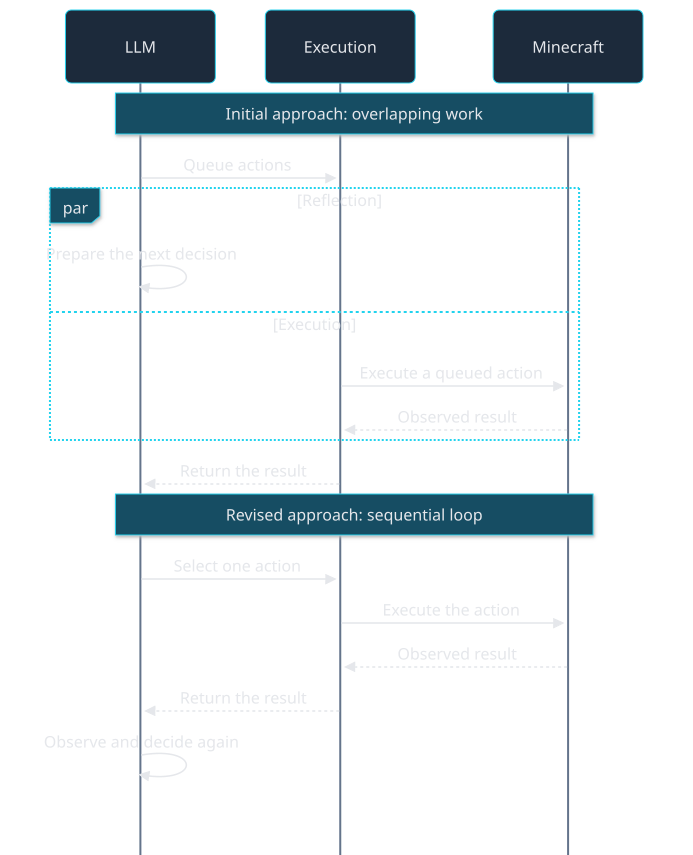
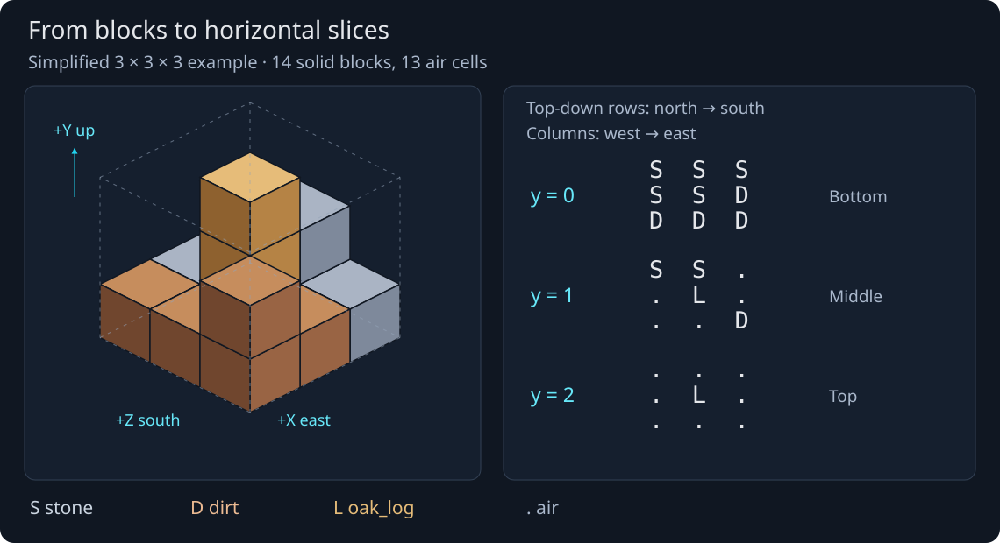
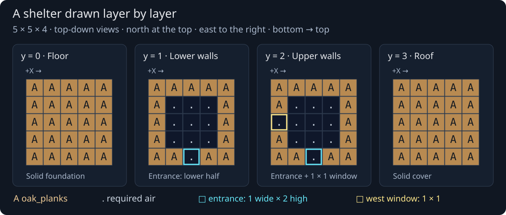
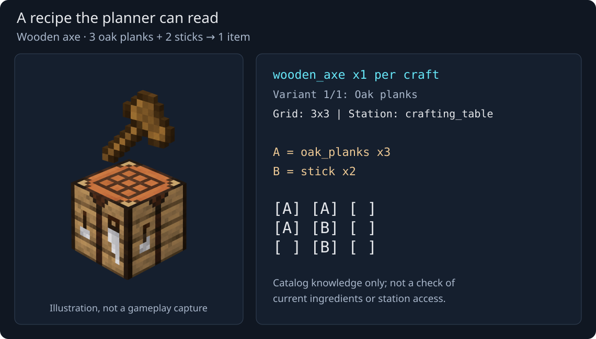

# Building a Minecraft Agent with a Local LLM

*Personal R&D project · 2026 · About 12 min read*

The goal of this project was to experiment with local language models in Minecraft. I wanted to see how far a model could get from a request in chat, from collecting wood to crafting tools and building a shelter. I developed a TypeScript prototype with Codex and Cursor, using Mineflayer to control the character. I chose to build a custom harness by handling and managing the responses and states of the LLM myself.

The project became a series of experiments in how much responsibility to give the model. I started by letting it choose small actions and think while they ran. I then switched to a more structured execution loop where the agent thinks, chooses and acts sequentially. I chose to build a custom multi-agent system with a few agents controlled by a coordinator. I also created a testing framework to repeat experiments and allow me to iterate in fixed conditions.

> *Screenshot to add: the bot completing a documented crafting task. Include the request and state which materials were supplied.*

## A scripted bot before the language model

Mineflayer is a JavaScript library that connects a programmable Minecraft character to a server and exposes its movements, interactions and observations through an API. This plugin basically "plays" as a real player.

I ran a local Minecraft server, joined it as a player, and connected the bot as another player. The first version used scripted capabilities such as `goto`, `equip`, `dig` and `place`. It could also read its inventory and search nearby blocks. This gave me a way to test the character's physical interactions before asking a model to choose them.



*The bot's initial interface. Solid arrows represent actions; dashed arrows represent observations. The character is an illustration, not a gameplay capture.*

I then exposed these operations to a local LLM through tools. The application supplied their descriptions and argument schemas; the model selected a tool and supplied JSON arguments. My code validated the call, executed it through Mineflayer and returned the result. The model could now choose what to do without generating the movement code itself.

## Strategy One: letting the model think while the bot acts

I connected a Qwen 9B model through Ollama, which served it locally through an API. The player communicated with the agent through Minecraft chat.

My first approach let the model think while the bot executed an action queue. I wanted it to prepare the next actions while walking or mining. A separate intent-classification prompt helped distinguish a question from a request to act. The agent could reply, or use tools such as `enqueue_tasks` and `resume_tasks` to manage execution.

The queue held actions waiting to run, in order. An executor performed them one at a time. Separately, a mailbox collected incoming chat messages and action results. These events could trigger another model call while execution continued, allowing the agent to revise the remaining queue.



*Two kinds of pending work: actions waiting to execute and events waiting for the model to process. A tool call that queues an action does not prove that action has finished.*

Within an interaction, the conversation grew through assistant tool calls followed by tool results so that the agent sees what it has been doing recently.

But I was now tracking a decision in progress, an action being executed, queued actions and completed actions whose results had not yet been processed. The model could plan from observations that were already outdated. Some requests also ended in an unnecessary “Could you clarify?”, while malformed arguments or truncated responses caused separate failures.

Watching the character did not tell me which of these problems I was seeing. I needed to inspect the conversation behind its behaviour. This is why I built a visual inspector to observe and monitor its thought process.

## Making the agent's decisions visible

I built a web inspector that records the messages sent to the model, the available tools, its responses and the execution results. I gradually added readable JSON, call ordering, timing and visible error states.

Being able to follow the agent's thought process let me distinguish a bad instruction from a bad tool call, and a successful call from an incorrect interpretation of its result. For example, the agent could reach a position near a tree and still fail to dig the intended block. Its assumption about access was wrong, even though the movement had succeeded.

> *Screenshot to add: one request in the web inspector, with the prompt, a tool call and its result visible. Choose a trace that shows the difference between movement success and block access.*

In these early trials, overlapping reflection and execution did not give me a clear benefit. I had made the control flow complicated before I could reliably explain its failures. I decided to simplify it.

## Strategy Two: think, decide, act, observe, repeat

The next version waited sequentially for an action to finish before asking the model what to do next. It could make a plan, choose an action, inspect the result, then continue, revise the plan or stop. This is way simpler than before and way easier to debug.



*Waiting for the result makes each decision easier to connect to an observed outcome.*

This made the sequence easier to follow, but did not make the model a good Minecraft player. It could still spend a long time deciding, repeat unsuccessful actions or misunderstand the world. Most of the issues became visible in the web UI by looking up the thought processes.

In parallel with this simplification, I introduced a separate administrator bot, the World Controller. It could reset a flat testing area, create trees and prepare the bot's inventory. I could now return to the same starting conditions instead of manually repairing the world after each attempt. It allowed for a clearer controlled test environment. As the experiments progressed I started noticing that the Qwen 9B model I was using was starting to be given too much information and too many tools for its size, which I thought could be a nice next subject to optimize.



*The World Controller prepares the test environment; it is separate from the AI-controlled player. The green-jacket character is an illustration, not a gameplay capture.*

## Separating conversation, planning and execution

The single agent was responsible for too much: answering the player, making a plan, selecting actions and deciding whether it had finished. I split these responsibilities into three roles, each with its own prompt:

- The **coordinator** handles the conversation, delegates work and keeps the checklist and reports.
- The **planner** produces high-level steps with success criteria. Initially, it returned a plan in one response.
- The **action agent** works on one delegated step, using Minecraft tools, then returns a report through `finish_step`.

These roles can use the same underlying model. Each sub-agent delegation starts with a fresh conversation and keeps its tool calls and results while working. Its report goes back to the coordinator, which decides the next sequence.

The action agent initially received too little information about the larger task. I later gave it the full plan, previous reports and the current step. I also removed artificial planning and review phases so it could inspect the world, act and reconsider within one conversation.

Separating the roles made their instructions easier to work on individually. It also exposed a more concrete limitation: the latency increased as more LLM calls had to be made for the agent to do something. Moreover, the output of the subagents was sometimes re-interpreted by the coordinator and produced inconsistent observations.

## Giving the agent a usable view of the world

The bot sometimes broke a log and declared success while the dropped item remained on the ground. Being near a block, reaching it, breaking it and collecting its drop needed separate checks. I feel that when the agent hallucinates like this it means it lacks vision or context.

I therefore expanded the observation tools: searches with a radius and result limit, individual block inspection, an ASCII voxel view, `get_block_access` for reach and visibility, and `get_dropped_items` for loose objects. The voxel view represents horizontal slices around the bot or a chosen position. It is a text representation of world data, not an image from a camera.



*The same cells, shown as blocks and as text. This simplified example is 3×3×3; the implemented observation tool reads a 5×5×4 volume. Layers run from bottom to top, with north at the top of each slice.*

Another issue was that the tool descriptions were too vague and misunderstood by the agent. I updated the descriptions to explain what an operation does, what its success proves and what it does not prove. Finding a block does not prove there is a path to it. Successful movement does not prove the block is within digging reach. Breaking it does not prove its drop entered the inventory.

> *Gameplay capture to add: a block being broken, its dropped item on the ground, then the confirmed inventory gain. The diagram above illustrates the representation, not a recorded run.*

Navigation needed work too. It could happen that the path finding would return partial paths or obscure errors such as "NO PATH FOUND" to the agent where it could have dug one block to access the target. I therefore improved path-failure feedback and allowed agent terrain changes, including breaking obstacles and placing scaffolding from the bot's inventory. This made the `goto` tool much more reliable for the agent to use and to understand what to do when it failed.

## From manual trials to repeatable scenarios

Resetting the world made manual experiments easier. But as I was testing more and more behaviors such as crafting or finding various resources it became clear that testing needed some automation. I decided to automate the full trial: prepare a fixed environment, connect a fresh test bot, send a request through chat, observe the result and clean up.

The tests use the real prompts and tools. Each scenario defines a time limit and its own success checks, which are not shown to the agent. Campaign reports record calls, errors, durations and observed state. I can inspect a failure without reconstructing it from console output. I also added an HTML report of the test campaign so that I can easily see and monitor where the agent lost time by looking at the tool calls.

> *Screenshot pending: the campaign report with a selected call, its prompt/result and the execution timeline. Keep the scenario's starting conditions and outcome visible.*

The first scenarios covered a crafting table, collecting logs and placing a block in front of the bot. I later expanded them to navigation, dropped items, scaffolding, food, storage and crafting chains. A passed test applies to its setup: crafting from supplied ingredients is a different problem from acquiring those ingredients first.

## Letting the model design a shelter

This one was tough as it requires lots of planning and spatial understanding. It gave me a reason to reconsider the level of control I wanted. I considered three approaches: let the model decide every block placement, give it the next block to place, or ask it for a complete design and build that design algorithmically.

I chose the third. An **Architect** agent creates a **Blueprint**. Code validates it, calculates the required materials and stores it outside the conversation under a reference. The coordinator can then ask the planner to organise resource gathering before delegating construction.

The **Builder** is an algorithmic controller, not another LLM agent. Through the `build` capability, it selects movements, equips materials, places blocks and checks the result. A model call is not required for every plank. I just thought that I should automate the repetitive tasks involving no abstract reasoning requirements as LLM calls are expensive and slow.



*The model designs the shelter and plans the work. The Builder executes the placements and verifies the world state; a valid drawing alone does not prove construction succeeded.*

The first Blueprint format asked too much at once: nested arrays, dimensions, a material palette, block properties and doors. Shape errors made it difficult to judge whether the model understood the building at all. I simplified its input to a multiline drawing: `A` for oak planks, `.` for required air, and a blank line between layers. The layers are horizontal, viewed from above, and stacked from bottom to top. The dimensions can be inferred from the drawing. I put actual doors aside and focused on shelters with an opening.



*An illustrative Blueprint matching the static shelter scene: `A` means oak planks and `.` means required air. The entrance spans both wall layers; no door item is placed. These are horizontal slices, not front views.*

I also built an isolated Architect web UI to inspect the exact prompts and validation feedback. It later gained a layer-by-layer experiment with a template grid and editable layers; the main Minecraft path still used the complete drawing. Validating a drawing's format was only the first check. I still needed to test whether it could be built and whether it matched the request.

> *Captures to add: a Blueprint in the Architect workshop and its corresponding in-game shelter. Label a staged scene as an illustration, and distinguish it from a build actually executed by the bot.*

### Trying a larger local model

The 9B model struggled with dimensions and spatial consistency, so I tried Qwen 27B through llama.cpp, then llama-swap. The application used a local OpenAI-compatible endpoint, which let me change the serving backend without rewriting the Minecraft tools. I chose to run a special Q4XS model that could fit with some context on my 16 GB GPU.

The new model produced more convincing designs in my trials. I had also been changing the prompts and validation feedback, so I cannot attribute all of the improvement to model size. This was an exploratory comparison, not a controlled benchmark.

## Automating repetitive collection

The Builder changed how I thought about gathering. I had originally wanted to watch the model decide every small action, but collecting several logs meant repeatedly choosing where to go, what to break and how to collect the drop.



*Simplified collection flow. No LLM call is made inside this loop. Reaching a target or breaking a block is not the stopping condition: the routine checks the inventory gain and returns a partial result if it cannot finish within its limits.*

I added `collect_resource`, a composite tool that handles this loop without internal LLM calls. The agent chooses a resource and quantity. The routine finds sources, checks the available harvesting tool, navigates, mines and confirms inventory gains. It returns a compact report, while the detailed sub-operations remain available under the parent call in the logs.

I also tightened confirmation of crafting and placement. A returned operation could precede the server's visible update, so the code polls the expected state at short intervals for a bounded time before reporting an unconfirmed result.



*The resulting division of work: agents choose goals, plans and designs; code performs repeated physical operations. World observations also inform coordination and planning.*

This gave up some of the fine-grained model control that had originally interested me. It also removed the need for a new model decision at every repeated gesture. Crafting then became a more visible source of mistakes where the agent failed to remember the correct recipes.

## Giving the planner recipes it could consult

The model sometimes got ingredients, quantities or recipe layouts wrong. I added a recipe library with an editable file per item, validated against the Minecraft data. It worked similarly as a regular skill provided to an agent. Its text output includes the result per craft, the required station, ingredients and a grid with cells such as `[A] [ ]`.



*The illustration is generated; the recipe text and grid follow the project's wooden-axe entry. Catalog knowledge describes how to craft the item, not whether the bot currently has the ingredients or can reach a crafting table.*

For example, a wooden axe needs three planks and two sticks arranged on a crafting table. Showing the layout alongside the quantities gives the agent more precise guidance than asking it to reconstruct the recipe from memory.

The planner also gained its own tool conversation. It could call `search_recipes`, read relevant entries through `read_recipe`, then finish with `submit_plan`. Selected recipes are referenced with the plan and supplied to the action agent for the relevant step. The coordinator no longer needs to paraphrase every ingredient and risk changing it during delegation.

This addressed recipe recall, but the coordinator still had to decide whether a step had succeeded. An action agent's confident report could be wrong.

## Checking success against the game state

I kept natural-language success criteria and added small expressions that the code can evaluate, such as:

```text
inventory_count(iron_pickaxe) >= 1
```

The planner can attach such a condition to a step. A parser accepts only the supported grammar; it does not execute arbitrary generated code. `evaluate_step` checks it, and `complete_step` checks again before marking the step complete.

The condition itself must still match the request. Possessing an item does not prove it was newly crafted. This is why the external scenarios retain independent checks instead of trusting whichever condition the planner wrote.

## Conclusion
